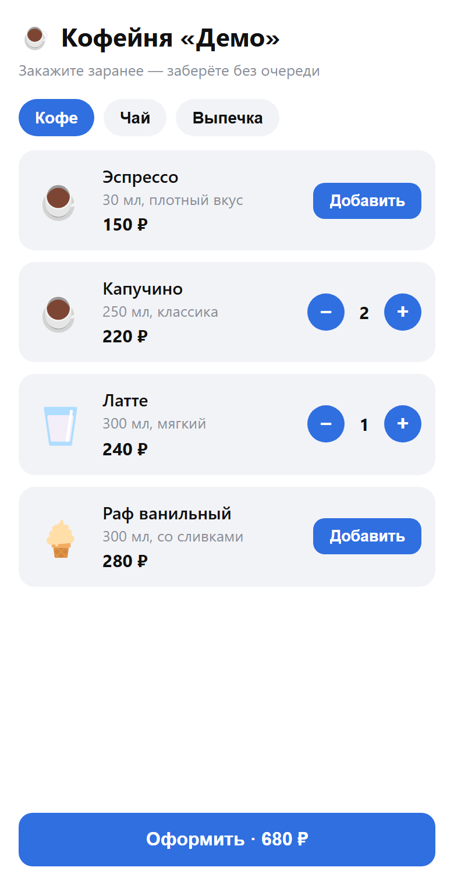
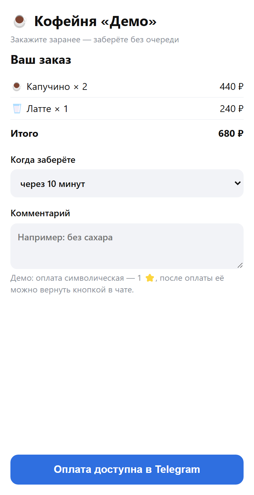
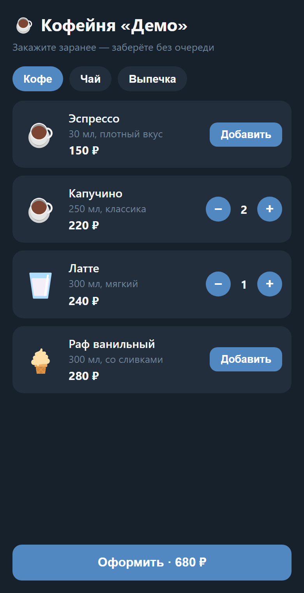

# mini-app-shop

Telegram Mini App «Кофейня»: меню → корзина → оплата прямо внутри Telegram → заказ админу.

| Меню | Оформление | Тёмная тема |
|---|---|---|
|  |  |  |

- Страница открывается кнопкой «Меню» в чате с ботом и **подстраивается под тему Telegram** пользователя.
- Корзина, кнопка «Оформить · 680 ₽» — **родная кнопка Telegram** (MainButton), «Назад» — тоже родная.
- Оплата — **внутри Mini App** (Telegram Stars; для рублей — магазин ЮKassa заказчика, как в booking-bot).
- После оплаты: подтверждение клиенту в чате, уведомление админу со списком заказа.
- В обычном браузере меню тоже открывается (для просмотра), заказ — только из Telegram.

## Безопасность — то, без чего Mini App нельзя отдавать заказчику
- **Проверка подписи Telegram (initData).** Страница передаёт серверу данные пользователя, подписанные Telegram
  ключом бота. Сервер проверяет подпись (HMAC-SHA256) и срок давности — без этого любой отправит заказ от чужого имени.
- **Сумму считает сервер.** Страница присылает только id товаров и количество; цены — из каталога на сервере.
  Проверено тестом: клиент прислал `"total": 1` — сервер выставил счёт на правильную сумму.

## Запуск
```bash
python -m venv venv
venv\Scripts\pip install -r requirements.txt
copy .env.example .env     # BOT_TOKEN, ADMIN_ID, WEBAPP_URL
python server.py           # веб-сервер (страница + API) и бот в одном процессе
```
`WEBAPP_URL` — публичный HTTPS-адрес (Telegram открывает Mini App только по HTTPS). Для разработки — туннель:
```bash
ssh -R 80:localhost:8080 nokey@localhost.run      # выдаст https://….lhr.life
```
Туннель Cloudflare (`cloudflared tunnel --url …`) — тоже вариант, но у части российских провайдеров его порт 7844 закрыт.

## Проверка
- `tests/test_server.py` — 17 проверок: настоящая подпись принимается; подменённый пользователь, чужой токен,
  отсутствие подписи и подпись старше 24 ч — отклоняются; сервер игнорирует сумму от клиента и отвергает
  несуществующие товары, отрицательные/строковые/огромные количества; страница без кэша.
- Живой тест (2026-10-07): заказ из Mini App → подпись настоящего пользователя принята → сумма 610 ₽ посчитана
  сервером → оплата 1 ⭐ → подтверждение и уведомление админу → возврат звезды.
